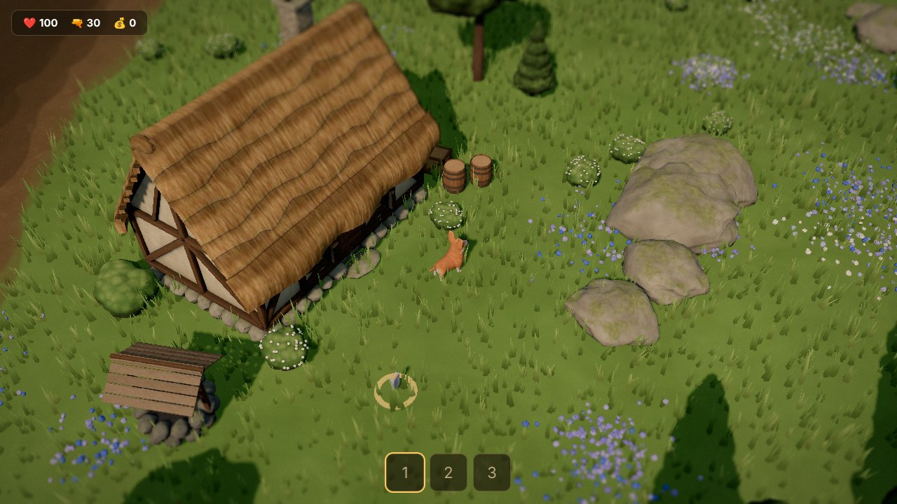
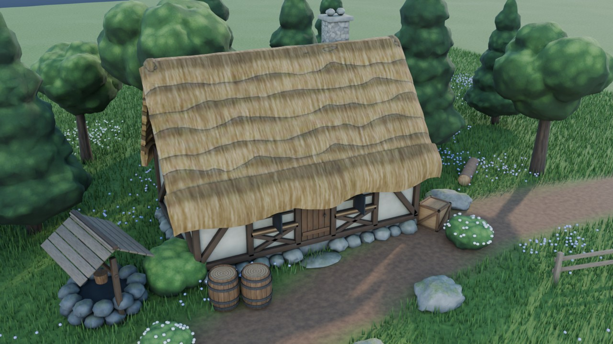
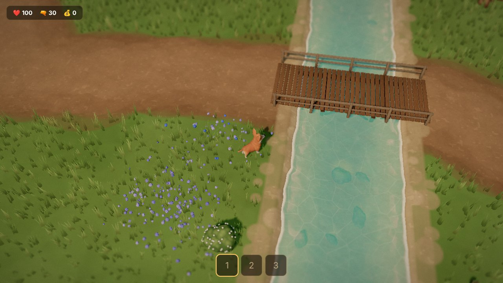
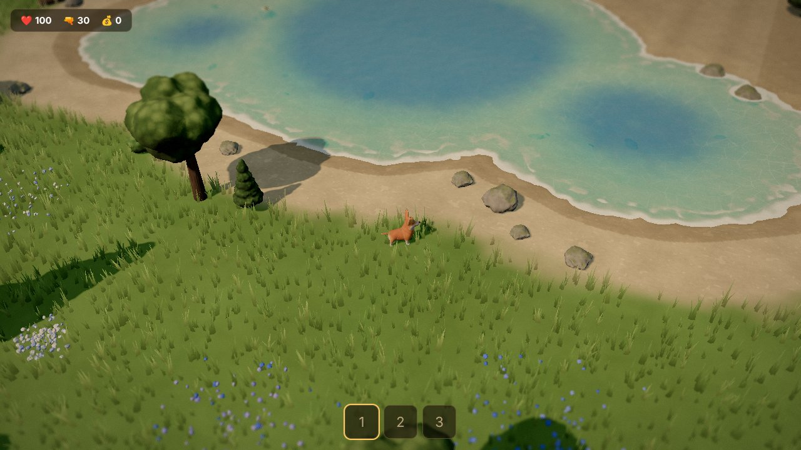
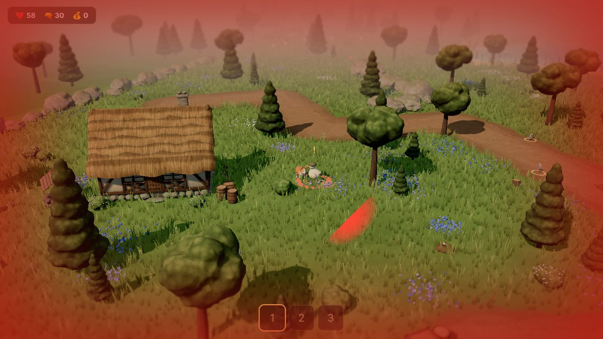
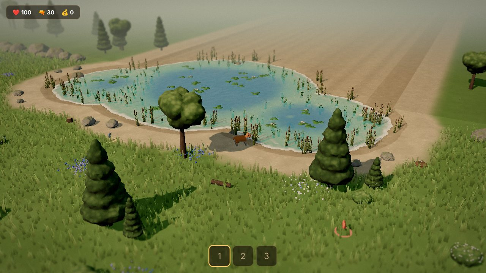
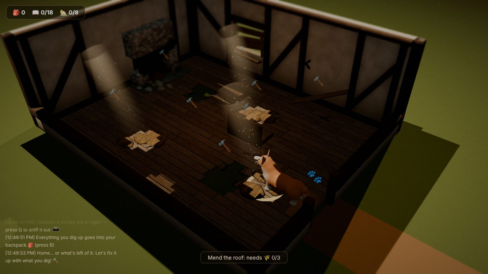
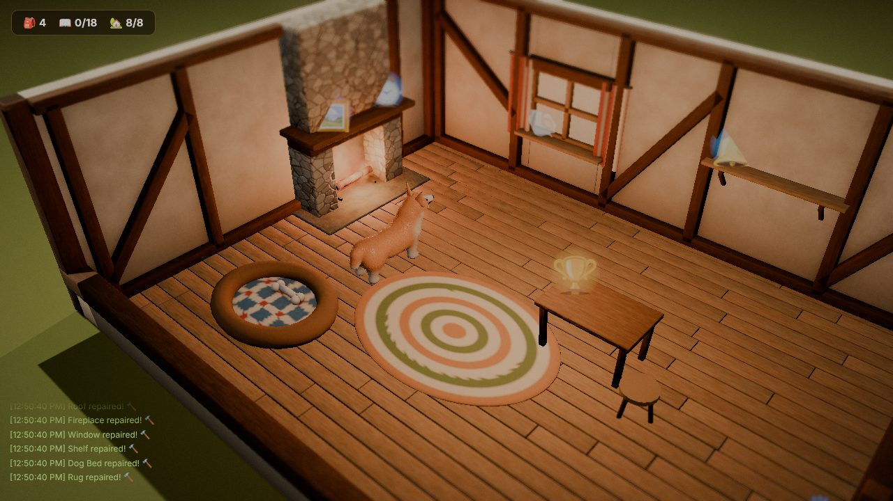

# 🐕 Dig, Corgi, Dig!

*(formerly Escape from Barkov)*

A cozy top-down treasure hunt: a corgi sniffs out and digs up buried treasure in a village full of mischievous ducks, then heads home to fix up a run-down cottage with what it found. Inspired by the look and feel of *Escape from Duckov*, minus the guns. Built with [Three.js](https://threejs.org/), no game engine, no bundler.

| In game (v0.6) | Same assets rendered in Blender Cycles |
|---|---|
|  |  |

| Stream | Lake |
|---|---|
|  |  |

| Ducks chase and peck (v0.8) | Reeds, waterweed and lilies (v0.8) |
|---|---|
|  |  |

| Home, as you find it (v0.11) | Home, fixed up and decorated (v0.11) |
|---|---|
|  |  |

## Play

```bash
npm install
npx serve . -l 5173
```

Then open **http://localhost:5173/** in your browser; the root redirects to the current version.

To publish as a static site, run `node tools/build-web.mjs`: `dist/` is self-contained (upload it anywhere, e.g. GitHub Pages), and `dist/artifact/` is the claude.ai Artifact variant (models converted from `.glb` to equivalent embedded glTF JSON).

> The legacy prototype (v0.3.5, single-file) is at `/v0.3.5.html`. The visual style prototype is at `/proto/`.
> Deterministic gameplay tests run in the browser at `/game/tests/run.html`.

## Controls

| Key | Action |
|-----|--------|
| `W A S D` | Run |
| Mouse wheel | Zoom in / out (clamped so models never get blurry) |
| `Shift` (hold) | Walk |
| `Q` | Sniff for buried treasure |
| `R` | Bark: nearby ducks flap away in a panic (short cooldown) |
| ⚙️ (top right) | Settings: language (English / 繁體中文) and music volume |
| `E` | Dig where your nose says "Right here!" · pick up something you dropped (or just walk over it) |
| `E` / `Space` / click (while digging) | Dig when the needle is in the green zone (gold = perfect) |
| `B` | Backpack |
| `Tab` | Treasure Book |
| `F` | Go home at the HOME gate |
| `E` (at home) | Repair what your nose points at · decorate a repaired shelf, mantel, sill or table · go back out at the door |
| `M` | Toggle music |

**Story:** every new game opens with a letter from the corgi's mom: the old family cottage in Barkov is his now, but it has been empty for years, and around the village are all the things she and his father buried when they were young. (The letter doubles as the loading screen; press *Let's go!* when it's ready.)

**Goal:** fill your backpack with treasure, then make your way from the west spawn to the HOME gate on the east side of the map, cross the ravine bridge, and press `F` to go home. There is no health, no weapon and no money. Ducks are mischievous rather than deadly: they chase you, and a peck (watch for the wind-up: a ring on the ground, the duck leans back) knocks you back and makes you drop one thing from your backpack, usually something common. It lands somewhere reachable nearby; walk over it (or press `E`) to pick it back up. Press `R` to bark: every duck within 10 m drops what it was doing (even a peck already winding up) and flaps away in a panic, then keeps its distance for a few seconds; barking has a 6-second cooldown, shown on the HUD. A duck that landed a peck waddles off happily for a while. Ducks look ahead as they walk: they steer around rocks, water and fences, turn back from the map edge, and pick a new direction if they ever get wedged in a corner. Treasure is buried out of sight; the ground looks like any other. Press `Q` and the corgi sniffs the ground: scent wisps drift in from the direction of the nearest treasure, and their color and count tell how close it is (cold → faint → warm → hot → *right here*). Once the nose says *right here*, press `E` and the corgi digs in front of its nose: the hole opens up, a dirt pile grows beside it and clods fly with every good shovel, and the treasure finally rises out of the hole. Digging is a timing minigame, and rarer treasures (Common → Uncommon → Rare → Epic → Legendary) are buried deeper, with a faster needle and a narrower zone. Three misses and the treasure slips away (you grab something common instead); moving or getting pecked by a duck interrupts the dig. Every find goes into your backpack (`B`, stacked by kind and sorted by rarity) and is recorded in the Treasure Book (`Tab`); both are saved in your browser. The corgi shows off each find to the camera. A new treasure is buried somewhere else after each find, and dug holes fill back in after a while. Ducks get faster and peck sooner the longer you play.

**Home:** the corgi's cottage starts out run-down: holes in the roof with sunbeams and dust falling through, a broken floor you have to walk around, a cold, half-collapsed fireplace, a boarded-up window, a fallen shelf, a tipped-over table, and no bed or rug. Walk up to something (the hammer markers show what can be fixed) and the tip says what it needs, for example two Old Planks and a Bent Nail for the floor. With the materials in your backpack, press `E`: the corgi gets to work, the materials are used up, the broken model is swapped for the repaired one in a puff of dust, and the room gets a little warmer and brighter. Mending the roof closes the sunbeams; lighting the fireplace adds flickering firelight. Repaired shelves, the mantel, the window sill and the table become display spots: press `E` to pick treasures from your backpack to show off (↩ puts one back). Repairs and displays are saved in your browser. The door takes you back out to dig. Common finds (planks, nails, straw, pebbles, bones) come out two at a time, because the cottage needs a lot of them.

## Project structure

```
game/            the current game (modular rebuild)
  index.html     UI shell
  assets/models/ Environment GLBs generated by tools/blender (baked color×AO + normal maps)
  src/
    config/      All balance numbers in one file (balance.js), treasure list & rarities (treasures.js), home stations & display spots (home.js)
    core/        Event bus, fixed-timestep game loop, input, asset loader
    render/      Post-processing (tilt-shift, color grade, vignette, bloom), camera rig, animation player
    world/       Painted ground, water, chunked instanced grass & flowers, water plants, world builder, the cottage interior (HomeScene)
    entities/    Player, Enemy
    ai/          Enemy state machine (patrol / chase / search) with a real FOV
    systems/     Collision, duck pecks, spawner, backpack, dig spots + dig minigame, treasure collection, home gate, home repairs & displays
    audio/       Synthesized SFX + BGM
    ui/          HUD (event-driven), screens, dig bar & reveal card, backpack, Treasure Book & display panels
tools/blender/   Procedural asset pipeline (Python + Blender): model → bake → GLB
proto/           Duckov-style visual prototype + shared 3D assets
index.html       Redirects to game/ (the current version)
v0.3.5.html      Legacy v0.3.5 single-file version (kept for reference)
```

### Architecture notes

- **Event bus:** systems never call each other directly; enemies emit `enemy:died`, and loot drops, SFX, kill counters, and the HUD each subscribe independently.
- **Fixed timestep:** logic ticks at a constant 60 Hz regardless of frame rate.
- **Data-driven balance:** every speed, range, drop rate, and difficulty curve lives in `game/src/config/balance.js`.
- **Measured, not assumed:** the bridge walk height is raycast-sampled from the actual model, and every collider is measured from the model's real footprint.
- **Shallow water you can see into:** the ground is a 3D mesh: flat (y = 0) everywhere the corgi can stand, dipping into a wide shallow stream and a lake on the south edge exactly where collision forbids walking, so nothing floats over a slope. Each water body bakes the ground height under it (plus rocks and bridge piles) into a texture; the water shader turns depth into color and transparency, wraps foam around every shoreline and obstacle, and pushes waves up the lake beach, while the ground shader draws animated caustics on the bed.
- **Collision that matches the visuals:** obstacles are circles, capsules (fences, rails, long boulders, logs) or rotated boxes (cottages, crates), backed by a spatial hash. The ravine is a band exactly as wide as its painted dark floor, with the bridge deck as the only opening, so the corgi can never be half on the bridge and half over the drop. The corgi itself collides as a capsule that follows its facing (nose and tail included), and every move/turn either resolves cleanly or falls back to sliding/staying put, so characters never end up wedged inside rocks.

## Characters

The corgi and the helmeted ducks are modeled in Blender too (`tools/blender/characters.py`), and the animations are keyframed in code and exported as glTF clips (30 fps), played in game with crossfades.

The corgi follows a real Pembroke Welsh corgi: a long, low body with a deep chest, very short thick legs, a fox-like head with tall cupped ears, an open smiling mouth with a pink tongue, and a red-sable coat with a white bib, muzzle blaze and socks. Its body is one smooth **metaball skin** (torso, neck, head, jaw, legs, tail blended together), and every vertex is weighted to the bones by the field strength of each body-part group, so the neck, shoulders and hips bend smoothly. Eyes, nose and ears are rigid parts placed by ray-casting onto the skin. In game the corgi gets **shell fur** (`game/src/render/Fur.js`): 12 skinned copies of the body pushed out along the normals, each keeping only thinning strand cross-sections, with per-vertex fur length baked from Blender (long on the chest ruff and tail, short on the face and paws, none on the eyes and nose). The ducks still use rigid parts.

| Character | Clips |
|-----------|-------|
| Corgi | `Idle`, `Walk` (diagonal trot), `Run` (bound gait), `Dig` (nose down, front paws paddling), `Proud` (turns to the camera, chest up, paws lifting, tail wagging) |
| Duck | `Idle`, `Walk` (waddle), `Run` (leaning, wings flapping), `Peck` (lean back = wind-up, then thrust) |

Water plants (reeds with cattails along the banks, waterweed swaying on the stream bed, lily pads and flowers on the lake) are instanced Blender models with a vertex-shader sway.

## Environment assets (Blender pipeline)

Every environment model (thatched cottages, the cottage interior (broken and repaired versions of every piece), well, spruce & broadleaf trees, shrubs, mossy rocks, fence, gate, bridge, barrels, crates, chest, stumps, logs) is generated **procedurally in Blender** by `tools/blender/`. Each asset is modeled from code, shaded with procedural node materials (straw, plaster, timber, stone, bark, foliage…), then Cycles bakes **color × ambient occlusion** and a **tangent-space normal map** into textures, and the result is exported as GLB. The game gets near-offline-render shading at real-time cost.

```bash
pip install bpy==5.2.2                      # Blender as a Python module (Python 3.13)
python tools/blender/build_assets.py        # → game/assets/models/*.glb  (~3 min on CPU)
python tools/blender/build_assets.py --only cottage,rock_a --res-scale 0.5   # quick iteration
python tools/blender/render_preview.py      # → docs/blender_preview.jpg (Cycles showcase)
```

(Or with a Blender install: `blender -b -P tools/blender/build_assets.py -- --out game/assets/models`.)

| File | What |
|------|------|
| `lib.py` | bmesh geometry helpers, shader-node builder, bake & export (per-group texture atlases) |
| `materials.py` | procedural materials |
| `assets.py` | one builder per asset + the asset table (texture size, AO distance, bake groups) |
| `characters.py` | corgi (metaball skin + smooth weights + fur length) & duck: modeling, bone layout and animation clips |
| `trees.py` | trees & shrubs: branching skeleton + alpha-cutout leaf cards with procedurally painted leaf / needle textures |

**Trees** are built like real ones instead of a blob canopy: a trunk with root flare splits into limbs and twigs (spruces get whorls of drooping branches), and the foliage is hundreds of leaf cards: quads textured with a leaf spray painted procedurally in numpy, cut out with alpha test in game (so their shadows are dappled too). The card normals point out from the crown center and a vertex color darkens the inside of the crown, so the canopy shades as one volume; while baking the bark, a shrunken copy of the leaves occludes the branches inside the crown. A small shader tweak raises the alpha with the mip level so distant trees don't go bald. Shrubs use the same recipe: woody stems from the ground, a crown of smaller blue-green leaf cards, and on the flowering ones five-petal white and pink blossoms on the outermost sprays.

## Credits

| Asset | Author | License |
|-------|--------|---------|
| Corgi, duck and environment models (`game/assets/models`) | Procedurally generated with Blender (`tools/blender/`) | n/a |
| Corgi model used by the legacy v0.3.5 (`luug_corgi_tales_of_arcadia.glb`) | [ofekyovel](https://sketchfab.com/ofekyovel) | CC-BY 4.0 |
| Voxel duck model used by `proto/` and v0.3.5 | [rbreve](https://sketchfab.com/rbreve) | CC-BY 4.0 |
| Proto environment (`proto/`) | [Kenney](https://kenney.nl/) (Nature Kit, Survival Kit, Platformer Kit, Blaster Kit) | CC0 |

Built with Three.js r164.
